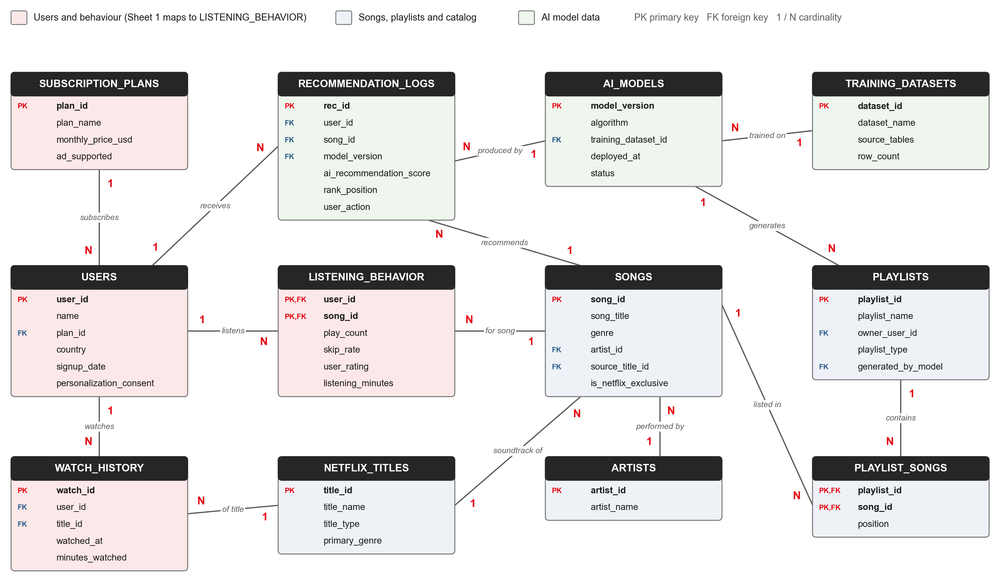
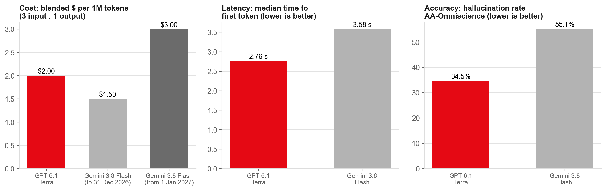
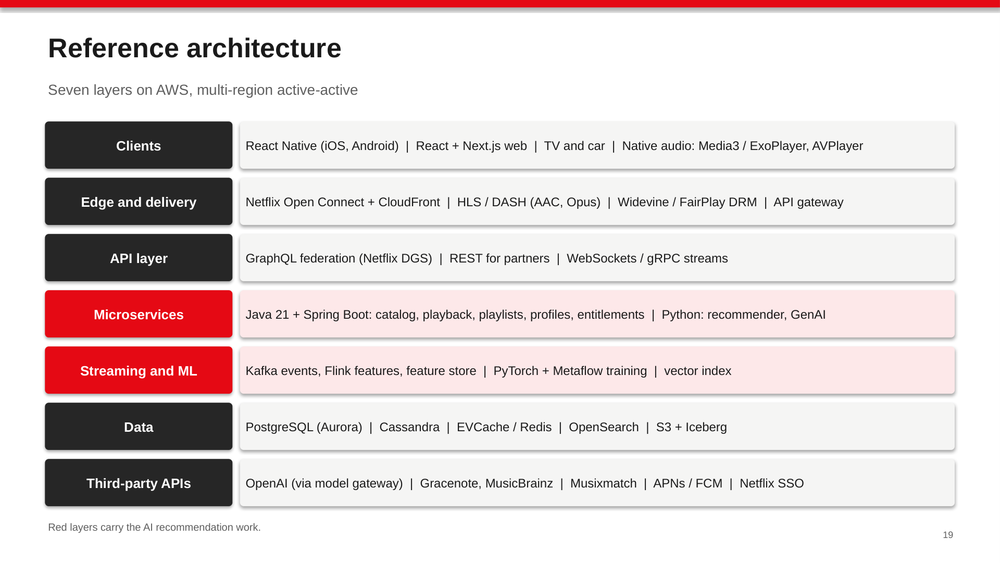
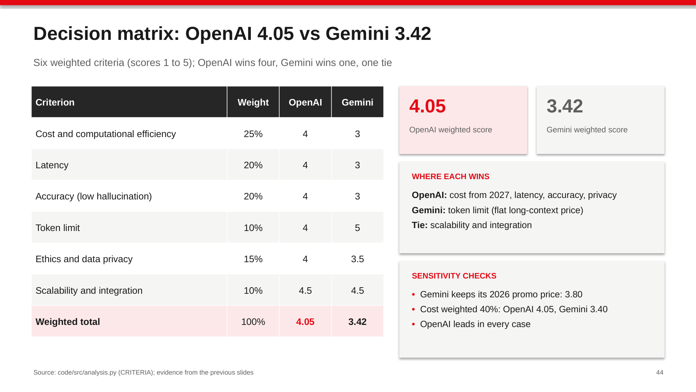

# Netflix Music: AI-Driven Music Experience (Course-End Project)

Technology Essentials for Product Managers. This code reads `data/CEP_Dataset.xlsx`, runs every analysis, builds the SQLite database for the ER diagram, renders all charts and diagrams, and writes the PowerPoint report, its PDF and one PNG per slide.

It continues the earlier Netflix Music product-sense project (personas, MVP, RICE / WSJF) with the technical delivery: stack, data model, GenAI model choice and Agile execution.

**Report:** [docs/Netflix_Music_AI_Experience_Report.pdf](docs/Netflix_Music_AI_Experience_Report.pdf) (61 slides)
**Kanban board:** the GitHub Project linked to this repository (Backlog, In Progress, Completed), one issue per sprint task

| ER diagram | GenAI: OpenAI vs Gemini |
| --- | --- |
|  |  |
| **Reference architecture** | **Decision matrix** |
|  |  |

## What the code produces

| Task in the brief | Dataset sheet | Output |
| --- | --- | --- |
| 1. Technology stack | n/a | Stack table, frontend scoring (React Native 4.60, Flutter 3.75, native 3.60), architecture, API assessment (slides 12-21) |
| 2. ER diagram | Sheet 1 - Music Data | `er_diagram.png` (12 entities), `netflix_music.sql` / `.db` (12 tables, 6 queries), correlations, baseline AI Recommendation Score, segments (slides 23-33) |
| 3. GenAI model (OpenAI vs Gemini) | n/a (researched 17 Nov 2026) | Cost, latency, token and accuracy tables, weighted decision matrix (OpenAI 4.05, Gemini 3.42) with sensitivity checks, monthly cost model (slides 35-46) |
| 4. Agile and Trello | Sheet 2 - Sprint Tasks | Kanban board render, `trello_cards.csv`, WSJF backlog ranking, sprint plan, metrics (slides 48-54) |

### Formulas

- **AI Recommendation Score (v1.0 baseline)** = 0.30 x plays + 0.25 x minutes + 0.25 x rating + 0.20 x (1 - skip rate), each min-max scaled to 0-1
- **WSJF** = (Business Value + Time Criticality + Risk Reduction) / Job Size, with a dependency rule (a card never ranks above a card it depends on)
- **Decision matrix** = sum of weight x score (1-5) over six criteria: cost 25%, latency 20%, accuracy 20%, token limit 10%, ethics and privacy 15%, scalability and integration 10%
- **GenAI monthly cost** = calls x (input tokens x (cached share x cached price + uncached share x input price) + output tokens x output price)

## Project structure

```
code/
├── data/CEP_Dataset.xlsx      # input: Sheet 1 - Music Data, Sheet 2 - Sprint Tasks
├── src/
│   ├── analysis.py            # scoring, correlations, segments, WSJF, GenAI benchmarks, decision matrix, cost model
│   ├── database.py            # SQLite schema for the ER diagram, sample data, 6 analysis queries
│   ├── charts.py              # ER diagram, data charts, Trello board, GenAI charts (matplotlib)
│   └── deck.py                # slide helpers (python-pptx)
├── build_visuals.py           # step 1: tables, database, figures, Trello card list
├── build_deck.py              # step 2: the 61-slide PowerPoint report (runs step 1 first)
├── render.sh                  # step 3: PPTX -> PDF (LibreOffice) -> one PNG per slide
├── render_slides.py           # PDF -> PNG helper used by render.sh
└── requirements.txt
```

## How to run

```bash
pip install -r requirements.txt
python build_deck.py        # writes output/ (tables, database, figures, PPTX)
./render.sh                 # writes output/*.pdf and output/slides/*.png (needs LibreOffice)
```

On macOS, LibreOffice installs with `brew install --cask libreoffice`. Set `SOFFICE=/path/to/soffice` if it lives elsewhere.

## Notes

- Sheet 1 has 10 rows, so statistics describe the sample. Names, artists, titles and plans in the database are labelled placeholders (Sheet 1 has IDs only).
- The brief mentions "Sheet 3 - Sprint Tasks" once; the workbook's sprint data is Sheet 2, which is used.
- GenAI prices, latency and accuracy are dated snapshots (Oct-Nov 2026) from the sources listed in `analysis.py` and on the sources slide. Re-check before relying on them.
- WSJF inputs, NFR targets, usage volumes and roadmap dates are planning assumptions.
